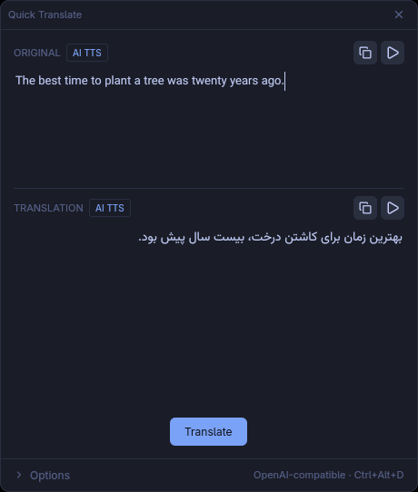
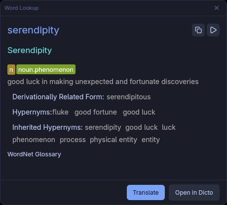

<p align="center"></p>

<h1 align="center">Dicto</h1>

<p align="center">A fast, offline desktop dictionary for Windows and Linux built in Rust. Reads MDX/MDD dictionary files — the same format used by GoldenDict, MDict, and most popular dictionary packs.</p>


## Features

- **Minimal, native UI** — built on GPUI (the engine behind Zed), renders at 120 fps with no Electron overhead
- **Instant search** — suggestions appear as you type, results load in milliseconds
- **Quick Translate** — select text in any app, press `Ctrl+Alt+D`, and a floating popup translates it with your own AI provider and reads it aloud with spoken-word highlighting ([docs/quick-translate.md](docs/quick-translate.md))
- **Word Lookup** — press `Ctrl+Alt+W` on a word for its dictionary definition in the same popup, with pronunciation audio and related-word suggestions — fully offline
- **System tray** — start hidden in the tray (`dicto --tray` or "Start in tray at login"); the menu triggers Quick Translate and Word Lookup and shows their hotkeys
- **Global shortcuts** — hotkeys work system-wide and register themselves with the OS (GNOME shortcuts / XDG portal on Wayland, native global hotkeys on X11 and Windows); rebindable in Settings → General
- **Single instance** — launching Dicto again raises the running window instead of opening a second copy
- **Faithful rendering** — full HTML output with per-dictionary CSS so each dict looks exactly as its author intended
- **Multi-dictionary** — load as many MDX files as you like, enable/disable/reorder them without restarting
- **Built-in dictionary download** — download dictionaries from within the app (Settings → Download tab, or on first launch)

## Highlights

### Quick Translate

<p align="center"></p>

Select text anywhere — browser, editor, PDF — press `Ctrl+Alt+D`, and Dicto
pops up over the current window with the translation (any OpenAI-compatible
provider, any target language) and text-to-speech playback that highlights
each spoken word as it is read.

### Word Lookup

<p align="center"></p>

Press `Ctrl+Alt+W` on any word to get its definition from your installed
dictionaries — offline, with pronunciation audio and related-word
suggestions.

## Installation

### Linux

[Download](https://github.com/logi-camp/dicto/releases/latest) — look for:

| File | Description |
| ---- | ----------- |
| `dicto-*-x86_64-unknown-linux-gnu.tar.gz` | Generic Linux binary |
| `dicto_*_amd64.deb` | Debian / Ubuntu package |

Extract the archive and run the binary.

### Debian / Ubuntu (APT repository)

Install and update via `apt`:

```bash
# 1. Add the repository signing key
sudo mkdir -p /etc/apt/keyrings
curl -fsSL https://logi-camp.github.io/dicto/dicto-archive-keyring.gpg | \
  sudo tee /etc/apt/keyrings/dicto-archive-keyring.gpg > /dev/null

# 2. Add the repository
echo "deb [signed-by=/etc/apt/keyrings/dicto-archive-keyring.gpg] https://logi-camp.github.io/dicto stable main" | \
  sudo tee /etc/apt/sources.list.d/dicto.list

# 3. Install
sudo apt update
sudo apt install dicto
```

Updates arrive with the usual `sudo apt update && sudo apt upgrade`.

Alternatively, download `dicto_*_amd64.deb` from
[Releases](https://github.com/logi-camp/dicto/releases/latest) and run
`sudo apt install ./dicto_*_amd64.deb`.

The package declares its runtime dependencies (`gtk3`, `alsa`, `xkbcommon`,
`zlib`) and a verified minimum `libc6` version derived from the shipped
binary, so `apt` refuses to install on systems where the binary would not
run instead of failing at launch. To build the `.deb` locally:

```bash
cargo build --release --package dicto
packaging/debian/build-deb.sh <version> target/release/dicto dist amd64
```

### Arch Linux (AUR)

Install from AUR using your preferred helper (e.g. `yay`, `paru`, `pikaur`).
Both packages are updated automatically by CI on every tagged release:

```bash
# Build from source
yay -S dicto

# Or install pre-built binary
yay -S dicto-bin
```

Or manually:

```bash
git clone https://aur.archlinux.org/dicto.git
cd dicto
makepkg -si
```

### Windows

[Download](https://github.com/logi-camp/dicto/releases/latest) — look for:

| File | Description |
| ---- | ----------- |
| `dicto-*-windows-x86_64-installer.exe` | Installer |
| `dicto-*-windows-x86_64-portable.zip` | Portable (no install needed) |

Requires [Visual C++ Redistributable (VC_redist.x64.exe)](https://aka.ms/vs/17/release/vc_redist.x64.exe)

### From source

```bash
cargo build --release --package dicto
# binary at target/release/dicto
```

**Runtime dependencies:** `gtk3`, `alsa-lib`, `libxkbcommon`, `lzo`

## Dictionary setup

**Option 1 — Download from the app:** Open Settings (⚙) → Download tab, pick a dictionary, and click Download. WordNet 3.1 (English, 155k+ words) is included. Dictionaries are installed to `~/.config/dicto/dicts/<id>/` and indexed automatically.

**Option 2 — Drop files manually:** Place `.mdx` (and optional `.mdd`) files into:

```text
~/.config/dicto/dicts/
```

Dicto auto-discovers them on next launch. No config editing needed.  
Enable, disable, and reorder dictionaries from the settings dialog (⚙ button).

## Command line

| Command | Effect |
| ------- | ------ |
| `dicto` | Open the dictionary window |
| `dicto --tray` | Start hidden in the system tray |
| `dicto --translate` / `-t` | Open Quick Translate for the current selection (Linux — bind to any desktop shortcut) |
| `dicto --lookup` / `-l` | Open Word Lookup for the current selection (Linux) |

## Supported formats

| Format | Status |
| ------ | ------ |
| MDX v2 (UTF-8, UTF-16) | ✓ Full support |
| MDX v1 | ✓ Full support |
| MDD resource containers | ✓ Images, audio, CSS |
| Encryption level 0, 2 | ✓ Supported |

## Architecture

The workspace has four crates:

- **`mdict-rs`** (library) — MDX/MDD parser, redb indexer, query pipeline, settings
- **`dicto`** (binary) — GPUI desktop app
- **`dicto-translate`** (library) — OpenAI-compatible translation and TTS providers used by Quick Translate
- **`telemetry`** (library) — opt-in anonymous analytics. Off by default; never transmits what you search for or which dictionaries you import. See [docs/telemetry.md](docs/telemetry.md).

## References

- [mdict-analysis](https://bitbucket.org/xwang/mdict-analysis) — MDX/MDD format specification
